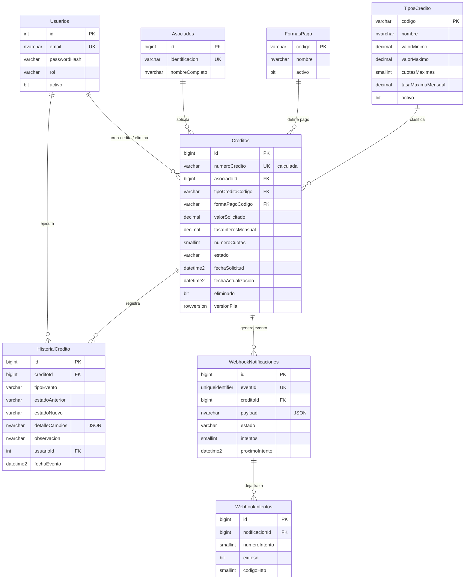

# Base de datos — Módulo de créditos

Modelo relacional en **Microsoft SQL Server 2022** para administrar solicitudes de crédito de asociados de una entidad del sector solidario.

## 1. Estructura de archivos

| Archivo | Contenido | Ambientes |
|---|---|---|
| `scripts/000_crear_base_datos.sql` | Base de datos, `READ_COMMITTED_SNAPSHOT`, tabla de versiones | Todos |
| `scripts/001_esquema.sql` | Tablas, llaves, restricciones, índices y triggers | Todos |
| `scripts/002_catalogos.sql` | Tipos de crédito y formas de pago | Todos |
| `scripts/900_datos_demo.sql` | Usuarios, asociados y créditos de demostración | **Solo desarrollo** |
| `seguridad/usuarios_aplicacion.sql` | Logins de la API y del worker con mínimo privilegio | Todos |
| `pruebas/validar_restricciones.sql` | Pruebas de restricciones, triggers, índices y permisos | Desarrollo / CI |
| `Dockerfile` | Imagen de SQL Server (versión fijada) y de migraciones | — |
| `ejecutar-scripts.sh` | Aplica los scripts (contenedor `db-init`) | — |
| `ejecutar-pruebas.sh` | Ejecuta las pruebas SQL | — |

### Versionamiento

Cada script se registra en `dbo.VersionesEsquema` y, si ya está aplicado, se omite completo (`SET NOEXEC ON`).

## 2. Diagrama entidad-relación



## 3. Justificación del diseño

### 3.1 Llaves primarias

| Tabla | Tipo de llave | Motivo |
|---|---|---|
| Creditos, Asociados, Historial, Webhook* | Sustituta `BIGINT IDENTITY` | Entidades transaccionales de alto volumen. Llave corta, inmutable y creciente, lo que evita fragmentar el índice agrupado. `BIGINT` cubre el escenario multi-entidad de 500.000 créditos/mes. |
| Usuarios | Sustituta `INT IDENTITY` | Volumen bajo (decenas o cientos de usuarios). |
| TiposCredito, FormasPago | Natural `VARCHAR(30)` (código) | Catálogos pequeños con código estable, que es el mismo valor que viaja en la API (`"LIBRE_INVERSION"`). |

Se descartó `UNIQUEIDENTIFIER` como PK: sus valores aleatorios fragmentan el índice agrupado y ocupan 16 bytes. El GUID se usa solo donde aporta, en el `eventId` del webhook, porque lo genera el emisor y es globalmente único entre sistemas.

### 3.2 Llaves foráneas

Todas las relaciones tienen FK declarada, **sin `ON DELETE CASCADE`** debido a que es información financiera nada debe desaparecer en cascada. Los créditos no se borran físicamente (borrado lógico).

### 3.3 Tipos de datos

| Dato | Tipo | Motivo |
|---|---|---|
| Valores monetarios | `DECIMAL(18,2)` | Exacto. `FLOAT` es binario aproximado puede generar descuadres. |
| Tasa de interés | `DECIMAL(7,4)` | **Tasa nominal mensual en %** (`1.5000` = 1,5 % mensual). Con 4 decimales cubre la precisión habitual de las tasas. |
| Cuotas | `SMALLINT` | Máximo 360 (30 años). |
| Fechas | `DATETIME2(3)` en **UTC** | Precisión de milisegundos, rango amplio y sin ambigüedad horaria. El frontend las convierte a hora de Colombia (UTC−5). |
| Identificación | `VARCHAR(20)` | No es un número: no se opera aritméticamente, puede tener ceros a la izquierda y letras (pasaporte). |
| Nombres | `NVARCHAR` | Unicode: tildes y ñ. |
| Estados y códigos | `VARCHAR` + `CHECK` | ASCII, ocupan la mitad que `NVARCHAR`. |

### 3.4 Restricciones (reglas garantizadas por la base de datos)

| Regla de la prueba | Restricción |
|---|---|
| `valorSolicitado > 0` | `CK_Creditos_valorSolicitado` |
| `tasaInteres >= 0` | `CK_Creditos_tasaInteres` (además ≤ 100 como control de cordura) |
| `numeroCuotas > 0` | `CK_Creditos_numeroCuotas` (además ≤ 360) |
| Estados válidos | `CK_Creditos_estado` |
| Créditos duplicados | `UX_Creditos_CreditoActivoPorTipo` (índice único filtrado) |
| Coherencia del borrado lógico | `CK_Creditos_borradoLogico` |
| Coherencia del historial | `CK_HistorialCredito_coherencia` |

**¿Por qué validar en la base de datos si la API ya valida?** Por defensa en profundidad. La API valida primero para dar mensajes claros (400/409/422), y la base de datos garantiza que ningún otro camino (scripts, procesos batch, soporte, condiciones de carrera) deje datos inválidos. Las **políticas configurables** (montos y plazos por tipo de crédito) y las **transiciones de estado** viven solo en la capa de dominio, para tener una única fuente de verdad.

### 3.5 Número de crédito

Es una columna **calculada y persistida**: `CR-<año>-<id con 6 dígitos>`.

- Se obtiene en el mismo `INSERT`, sin condiciones de carrera entre instancias de la API.
- Es **inmutable por construcción**, porque una columna calculada no admite `UPDATE`.
- Es única, porque se deriva del id (además se declara `UNIQUE`).

### 3.6 Manejo de estados

```
SOLICITADO ──► EN_ESTUDIO ──► APROBADO ──► DESEMBOLSADO
    │              │  │           │
    │              │  └─► RECHAZADO
    └──────────────┴──────────────┴──► CANCELADO
```

`RECHAZADO`, `DESEMBOLSADO` y `CANCELADO` son estados finales. La base de datos garantiza con `CHECK` que el estado sea válido y, con el trigger `TR_Creditos_ProtegerIntegridad`, que un estado final no cambie. Las transiciones intermedias las valida el dominio de la API.

### 3.7 Índices

| Índice | Consulta que optimiza |
|---|---|
| `IX_Creditos_FechaSolicitud` (filtrado `eliminado = 0`) | Listado por defecto, ordenado del más reciente al más antiguo |
| `IX_Creditos_Estado_FechaSolicitud` (filtrado) | Filtro por estado y conteos del dashboard |
| `IX_Creditos_AsociadoId` | Filtro por identificación del asociado y validación de duplicados |
| `UQ_Asociados_identificacion` | Búsqueda exacta por identificación |
| `IX_Asociados_nombreCompleto` | Búsqueda por prefijo del nombre |
| `IX_HistorialCredito_CreditoId_FechaEvento` | Historial cronológico en el detalle |
| `IX_WebhookNotificaciones_Pendientes` (filtrado) | Sondeo del worker; se mantiene pequeño aunque haya millones de eventos enviados |

Los índices de listado usan `INCLUDE` para cubrir las columnas de la grilla sin volver a la tabla base. Las FK hacia catálogos no se indexan, porque los catálogos no se borran y tienen pocas filas.

### 3.8 Información mutable e inmutable

| Inmutable siempre | Editable solo en SOLICITADO / EN_ESTUDIO | Cambia por flujo |
|---|---|---|
| id, numeroCredito, asociado, fechaSolicitud, usuario creador | valorSolicitado, tasaInteres, numeroCuotas, tipoCredito, formaPago | estado (endpoint dedicado), fechaActualizacion |

Además, el **historial y la traza del webhook son de solo inserción**: tienen triggers `INSTEAD OF UPDATE, DELETE` que rechazan cualquier modificación.

### 3.9 Concurrencia

- **`READ_COMMITTED_SNAPSHOT ON`**: las lecturas (dashboard, listados) no se bloquean con las escrituras.
- **`ROWVERSION` (`versionFila`)**: permite concurrencia optimista. Si dos analistas editan el mismo crédito, el segundo recibe 409 en lugar de sobrescribir el cambio del primero.

### 3.10 Webhook: outbox transaccional

El crédito, su evento de historial y el evento `credito.creado` se insertan en **una sola transacción**. Un worker envía después los eventos `PENDIENTE` con reintentos y espera exponencial; cada intento queda en `WebhookIntentos`. Si el sistema externo no responde, el crédito ya está creado y la notificación se reintenta hasta `maxIntentos`. Después queda en `FALLIDO`, visible para reproceso manual.

### 3.11 Usuarios de la aplicación con mínimo privilegio

La API y el worker **no se conectan como `sa`**. Cada uno tiene su propio login y un rol con solo los permisos que su código usa. La matriz se derivó de las consultas SQL de `api/src`:

| Tabla | `app_creditos_api` | `app_creditos_worker` |
|---|---|---|
| Usuarios, TiposCredito, FormasPago | `SELECT` | — |
| Asociados | `SELECT`, `INSERT` | — |
| Creditos | `SELECT`, `INSERT`, `UPDATE` **solo en 11 columnas** | — |
| HistorialCredito | `SELECT`, `INSERT` (`DENY UPDATE`) | — |
| WebhookNotificaciones | `SELECT`, `INSERT`, `UPDATE` de 4 columnas (reprogramar) | `SELECT`, `UPDATE` de 7 columnas (resultado del envío) |
| WebhookIntentos | `SELECT` | `INSERT` (`DENY UPDATE`) |
| VersionesEsquema | — | — |
| Todo el esquema | `DENY DELETE` | `DENY DELETE` |

**Dos logins y no uno.** El worker guarda el secreto HMAC y se conecta a un sistema externo: es la pieza más expuesta. Si se compromete, no puede leer ni modificar créditos, asociados ni usuarios (ni los hash de contraseñas). Tampoco puede cambiar `urlDestino` ni `payload`, así que no podría redirigir notificaciones con datos de asociados a otro servidor, ni ampliar sus propios reintentos.

**`UPDATE` por columna en `Creditos`.** La API solo puede actualizar las condiciones editables, el estado, la auditoría de modificación y el borrado lógico. Cambiar el asociado, la fecha de solicitud o el creador falla por **permisos** (error 230), antes de llegar al trigger `TR_Creditos_ProtegerIntegridad`. Son dos barreras independientes.

**`DENY DELETE` en todo el esquema.** El borrado de créditos es lógico y el historial es inmutable. `DENY` prevalece sobre cualquier `GRANT`, así que la regla se mantiene aunque alguien agregue el usuario a `db_datawriter`.

**Permisos a roles, no a usuarios.** Si mañana hay varias réplicas de la API con logins distintos, todas entran a `rol_api_creditos`.

**Estado deseado, no migración.** `usuarios_aplicacion.sql` no lleva número de versión: `db-init` lo aplica en **cada** arranque. Crea lo que falta, actualiza las contraseñas, vuelve a enlazar usuarios huérfanos tras restaurar un respaldo y **recrea los roles** con exactamente los permisos del archivo. Un permiso que se borre del archivo desaparece de la base, y quien se haya agregado a mano a un rol queda fuera. Todo ocurre en una transacción, para que la API en ejecución nunca vea permisos a medias.

**`sa` solo aprovisiona.** Lo usan `db-init` (migraciones y logins) y el healthcheck del motor. La API y el worker nunca reciben `MSSQL_SA_PASSWORD`, y la API se niega a arrancar en producción si `DB_USER` es `sa`. En un ambiente real, el aprovisionamiento lo haría un pipeline o un DBA con una identidad propia, y las claves vendrían de un gestor de secretos.

Las contraseñas llegan a `sqlcmd` como variables de entorno y no como argumentos, para que no aparezcan en la lista de procesos. `ejecutar-scripts.sh` rechaza comillas (romperían la sentencia `CREATE LOGIN`) y exige que las tres claves sean distintas.

## 4. Ejecución

El motor y los scripts se ejecutan **solo con Docker**, a partir de `database/Dockerfile`.

| Etapa del Dockerfile | Servicio | Función |
|---|---|---|
| `sqlserver` | `db` | Motor SQL Server 2022 Developer con versión fijada y healthcheck |
| `migraciones` | `db-init` | Lleva los scripts **dentro de la imagen**, los aplica y termina |

Los scripts van dentro de la imagen y no como volumen montado. Así ni los permisos ni los finales de línea de Windows pueden alterar su ejecución.

```powershell
copy .env.example .env          # y definir MSSQL_SA_PASSWORD, DB_API_PASSWORD, DB_WORKER_PASSWORD y JWT_SECRET
docker compose up -d --build db db-init
docker compose logs -f db-init  # debe terminar con "✔ Base de datos lista."

# Pruebas de restricciones y permisos (44 casos; termina con error si alguno falla)
docker compose run --rm --entrypoint /database/ejecutar-pruebas.sh db-init
```

Para conectarse desde SSMS o Azure Data Studio: servidor `localhost,14330`, usuario `sa` y la contraseña definida en `.env`. También puede entrar con `app_creditos_api` o `app_creditos_worker` y comprobar en vivo qué les está permitido. El final del log de `db-init` lista cada permiso otorgado. Para empezar desde cero (borrar los datos): `docker compose down -v`.

## 5. Consultas de verificación

```sql
USE CreditosOPA;

SELECT * FROM dbo.VersionesEsquema;

-- Conteo por estado (base del dashboard)
SELECT estado, COUNT(*) AS cantidad
FROM dbo.Creditos
WHERE eliminado = 0
GROUP BY estado;

-- Historial de un crédito
SELECT c.numeroCredito, h.tipoEvento, h.estadoAnterior, h.estadoNuevo,
       h.observacion, u.email, h.fechaEvento
FROM dbo.HistorialCredito h
JOIN dbo.Creditos c ON c.id = h.creditoId
JOIN dbo.Usuarios u ON u.id = h.usuarioId
ORDER BY c.id, h.fechaEvento;

-- Traza del webhook
SELECT n.eventId, n.estado, n.intentos, i.numeroIntento, i.exitoso, i.codigoHttp, i.error
FROM dbo.WebhookNotificaciones n
JOIN dbo.WebhookIntentos i ON i.notificacionId = n.id
ORDER BY n.id, i.numeroIntento;
```
