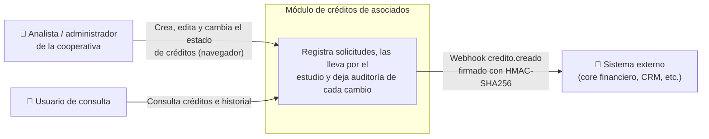
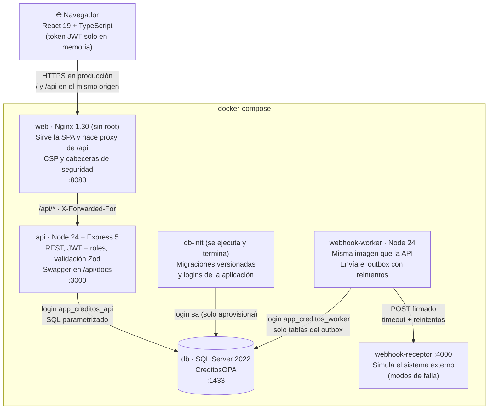
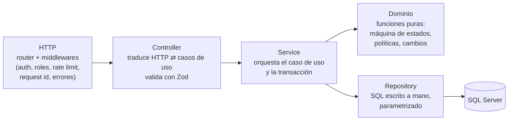
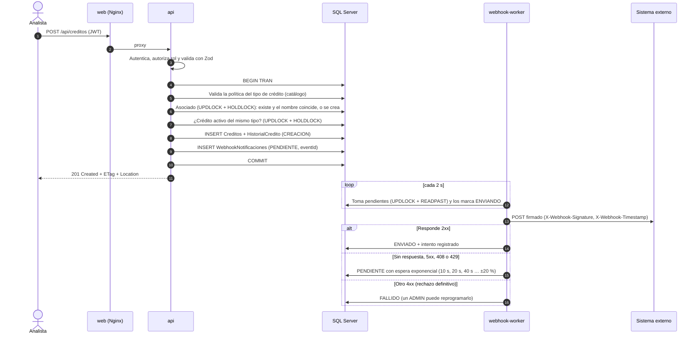

# Arquitectura

Este documento describe cómo está construido el módulo de créditos tal como se
entrega (todo en `docker-compose`), cómo fluye una solicitud de punta a punta y
qué componentes guardan estado. La propuesta para producción y el crecimiento a
500.000 créditos mensuales están en
[despliegue-y-escalabilidad.md](despliegue-y-escalabilidad.md).

## 1. Contexto

Quién usa el sistema y con qué otros sistemas habla.

## 2. Contenedores

Cada caja es un contenedor del `docker-compose.yml`. Las flechas indican quién
inicia la comunicación.

| Contenedor | Responsabilidad | Tecnología | Documentación |
|---|---|---|---|
| `web` | Interfaz para analistas; proxy hacia la API | React 19, Vite 8, Tailwind 4, Nginx 1.30 | [web/README.md](../web/README.md) |
| `api` | Reglas de negocio, seguridad, persistencia, encolado del webhook | Node 24, Express 5, TypeScript 6, Zod 4, mssql | [api/README.md](../api/README.md) |
| `webhook-worker` | Entrega de notificaciones con reintentos y traza | Misma imagen de la API (`node dist/worker.js`) | [api/README.md](../api/README.md) |
| `db` | Datos, restricciones, triggers de integridad | SQL Server 2022 CU26 | [database/README.md](../database/README.md) |
| `db-init` | Aplica scripts versionados y permisos, y termina | sqlcmd sobre la misma imagen | [database/README.md](../database/README.md) |
| `webhook-receptor` | Sistema externo de prueba: valida firma, simula caídas | Node 24 sin dependencias | [webhook-receptor/README.md](../webhook-receptor/README.md) |

**Por qué el worker es un contenedor aparte y no un temporizador dentro de la
API.** Si la API se escala a varias réplicas, cada una tendría su propio
temporizador compitiendo por los mismos eventos. Separado, el envío escala de
forma independiente, un sistema externo lento no consume los recursos que
atienden a los analistas, y el worker puede tener un login de base de datos
con muchos menos permisos.

## 3. Capas dentro de la API

- El **dominio** no conoce HTTP ni SQL: es la única fuente de verdad de las
  reglas (por ejemplo, qué transiciones de estado se permiten). La API incluye
  en cada crédito `transicionesPermitidas`, `editable` y `eliminable`, así el
  frontend no duplica esas reglas.
- Los **repositorios** reciben la transacción del servicio. Así el crédito, su
  historial y el evento del webhook se guardan juntos o no se guarda ninguno.
- Los módulos se organizan por negocio (`creditos`, `auth`, `catalogos`,
  `webhooks`, `health`), no por tipo de archivo.

## 4. Flujo: crear un crédito y notificar al sistema externo

El webhook usa el patrón **outbox transaccional**. La API no llama al sistema
externo: deja el evento guardado en la misma transacción del crédito y el
worker lo entrega después.

**Qué garantiza este diseño:**

- **El crédito nunca se pierde por culpa del sistema externo.** Si el externo
  está caído, el crédito ya está guardado y la notificación se reintenta.
- **Nunca hay una notificación de un crédito que no existe.** El evento se
  guarda en la misma transacción: si algo falla, se deshacen ambos.
- **Entrega al menos una vez, sin duplicados para el receptor.** Si el worker
  se cae después de enviar pero antes de registrar el resultado, el evento se
  reenvía. El receptor descarta duplicados por `eventId`.
- **Varios workers en paralelo sin enviar dos veces.** `UPDLOCK + READPAST`
  hace que cada evento lo tome un solo worker y que ninguno espere por otro.
- **Trazabilidad.** Cada intento (código HTTP, duración, error) queda en
  `WebhookIntentos` y se ve en el detalle del crédito.

## 5. Qué es stateless y qué guarda estado

| Componente | ¿Guarda estado? | Detalle | Cómo escala |
|---|---|---|---|
| `web` (Nginx) | **No** | Solo archivos estáticos y proxy | Réplicas detrás del balanceador o CDN |
| `api` | **No**¹ | JWT autocontenido: no hay sesiones en memoria. Cualquier réplica atiende cualquier petición | Réplicas horizontales |
| `webhook-worker` | **No** | El estado de cada envío vive en la base de datos, no en memoria | Réplicas: compiten por los eventos sin duplicar |
| `db` (SQL Server) | **Sí** | Créditos, historial, usuarios, outbox y traza | Vertical, réplicas de lectura, una base por cooperativa |
| Volumen `sqlserver-data` | **Sí** | Archivos de datos y logs de SQL Server | Respaldado por backups |
| Navegador | Temporal | El token vive solo en memoria de la página: al recargar se pide login | — |

¹ Con una excepción conocida: el contador del límite de intentos
(`express-rate-limit`) vive en memoria de cada réplica. Con una sola réplica es
correcto; con varias, cada una cuenta por separado y el límite efectivo se
multiplica. La solución está en el documento de escalabilidad (almacén
compartido en Redis).

## 6. Seguridad por capas

Cada capa asume que la anterior puede fallar.

| Capa | Mecanismo | Qué evita |
|---|---|---|
| Navegador | Token solo en memoria, CSP `script-src 'self'` | Robo persistente del token por XSS |
| Nginx | Mismo origen, CSP, `nosniff`, `frame-ancestors 'none'`, límite de 100 kB, reemplazo de `X-Forwarded-For` | Clickjacking, inyección de scripts, IP falsificada |
| API: entrada | Helmet, CORS con lista blanca, límite de intentos de login por IP real, Zod estricto | Fuerza bruta, campos inesperados, datos inválidos |
| API: identidad | JWT HS256 con algoritmo fijado, emisor, audiencia y vencimiento validados; bcrypt; respuesta igual si el correo no existe | Tokens alterados, enumeración de usuarios |
| API: autorización | Roles ADMIN / ANALISTA / CONSULTA en cada ruta | Que la UI sea la única barrera |
| API: concurrencia | `If-Match` con `ROWVERSION` (412 si otro guardó primero) | Sobrescribir el cambio de otro analista |
| Base de datos: datos | `CHECK`, llaves foráneas, índice único filtrado, triggers de inmutabilidad | Datos inválidos por cualquier camino (scripts, soporte, carreras) |
| Base de datos: permisos | Dos logins con mínimo privilegio, `UPDATE` por columna, `DENY DELETE` | Que un componente comprometido haga más de lo que necesita |
| Webhook | HMAC-SHA256 sobre `timestamp.cuerpo`, tolerancia de 5 minutos | Notificaciones falsas o repetidas fuera de tiempo |
| Secretos | Solo en `.env` (fuera del repositorio); la API no arranca sin ellos ni con `sa` en producción | Secretos en el código o configuraciones inseguras por descuido |
