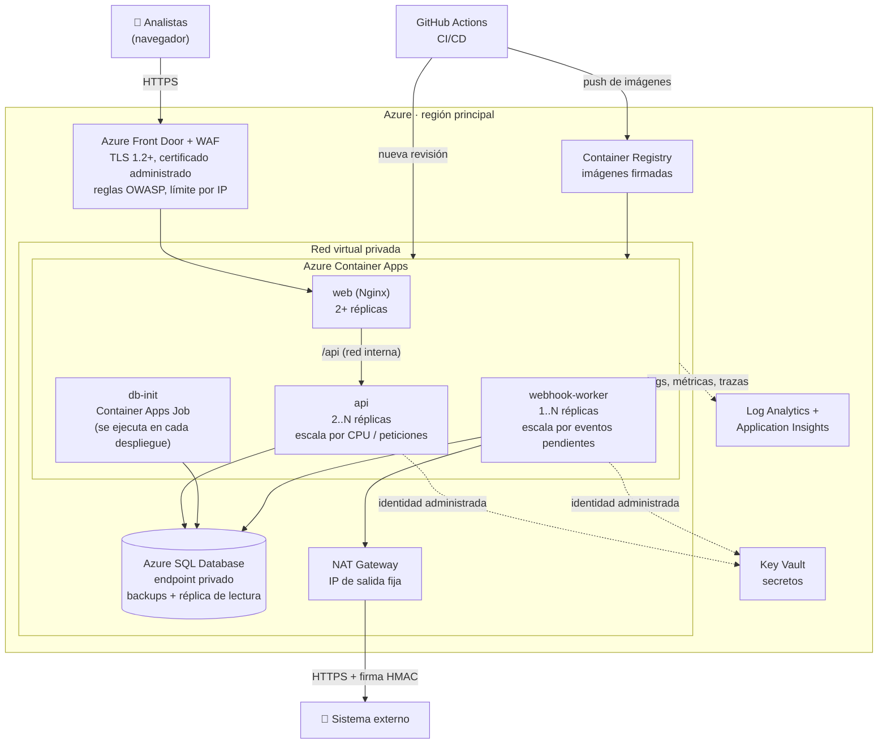
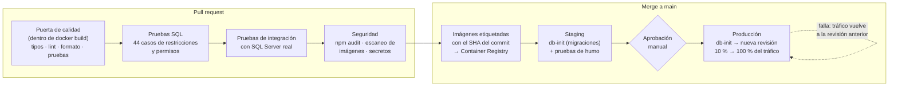
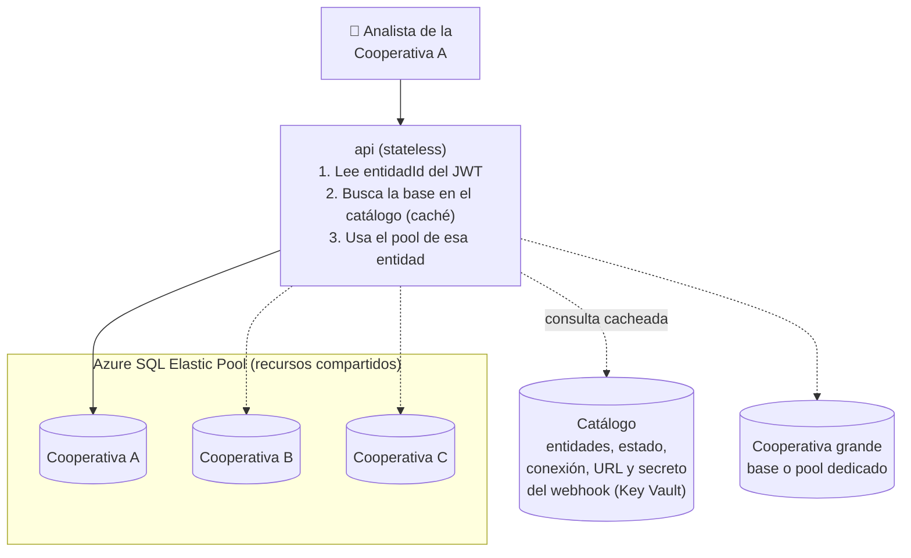
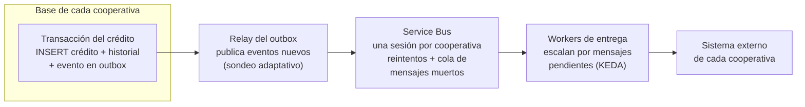

# Despliegue y escalabilidad

Este documento responde los puntos 16 y 17 de la prueba:

- **Parte A:** cómo se expondría la aplicación en producción (HTTPS, secretos,
  backups, logs, health checks, monitoreo y CI/CD).
- **Parte B:** qué cambiaría para pasar de 500 a 500.000 créditos mensuales con
  varias cooperativas.

La arquitectura actual está en [arquitectura.md](arquitectura.md). La propuesta
se aterriza en **Azure** porque SQL Server es nativo allí: Azure SQL Database
trae backups automáticos, restauración a un punto en el tiempo y réplicas, y
las mismas imágenes Docker del repositorio corren sin cambios. 

---

## Parte A. Despliegue en producción

### A.1 Arquitectura de producción

| Componente | Servicio | Por qué |
|---|---|---|
| Entrada | **Azure Front Door + WAF** | Termina TLS con certificado administrado (renovación automática), filtra ataques comunes (OWASP) y oculta los contenedores detrás de un solo punto público |
| Contenedores | **Azure Container Apps** | Corre las mismas imágenes del `docker-compose` y escala por réplicas, incluso a partir de métricas externas como los eventos pendientes (KEDA). Para este tamaño, Kubernetes completo agregaría operación sin beneficio |
| Base de datos | **Azure SQL Database** | El mismo motor del desarrollo, sin administrar servidores. Incluye backups, alta disponibilidad y réplica de lectura |
| Secretos | **Key Vault** + identidad administrada | Las aplicaciones leen los secretos sin tener ninguna clave guardada |
| Salida | **NAT Gateway** | El sistema externo puede autorizar una IP fija de origen para los webhooks |
| Observabilidad | **Log Analytics + Application Insights** | Logs centralizados, métricas, trazas y alertas en un solo lugar |

**Qué es stateless y qué guarda estado.** `web`, `api` y `webhook-worker` no
guardan estado: se pueden destruir, reemplazar o multiplicar sin perder nada.
Todo el estado vive en Azure SQL (créditos, historial, outbox y traza de
envíos), que es lo único que se respalda. El detalle está en
[arquitectura.md §5](arquitectura.md#5-qué-es-stateless-y-qué-guarda-estado).

### A.2 HTTPS y red

- **TLS de punta a punta.** El navegador habla HTTPS con Front Door (TLS 1.2 o
  superior). Front Door llega a Container Apps también por HTTPS, y la API a
  Azure SQL con `DB_ENCRYPT=true` y **`DB_TRUST_SERVER_CERTIFICATE=false`**.
  El certificado autofirmado solo se acepta en el `docker-compose` local.
- **HSTS.** Helmet ya envía `Strict-Transport-Security`: el navegador no vuelve
  a intentar HTTP con ese dominio.
- **Nada expuesto sin necesidad.** Solo Front Door es público. La API no tiene
  ingreso externo (solo la alcanza `web` dentro de la red) y Azure SQL solo
  acepta conexiones por su endpoint privado. En el compose local el puerto 3000
  se publica para Swagger; en producción, `API_DOCS_ENABLED=false` o
  documentación solo interna.
- **IP real del usuario.** Con Front Door delante de Nginx hay dos proxies, así
  que `TRUST_PROXY_HOPS` pasa a `2`. La API debe contar los saltos reales: si
  confía en más proxies de los que hay, cualquiera puede falsificar su IP.

### A.3 Variables y secretos

| Hoy (local) | Producción |
|---|---|
| `.env` fuera del repositorio, `.env.example` sin secretos | **Key Vault**: `JWT_SECRET`, `WEBHOOK_SECRET` y las credenciales de base de datos |
| Contraseñas de los logins `app_creditos_*` | **Autenticación de Microsoft Entra ID con identidad administrada**: la API y el worker se conectan a Azure SQL sin contraseña. Los usuarios de base de datos y los permisos mínimos son los mismos (`rol_api_creditos`, `rol_worker_webhooks`) |
| La API no arranca si falta un secreto o si usa `sa` en producción | Se mantiene. Además, Container Apps referencia los secretos de Key Vault y no los copia |

- **Rotación sin caída:** `JWT_SECRET` se rota aceptando por un tiempo la clave
  vieja y la nueva (verificación con ambas) y luego retirando la vieja. El
  secreto del webhook se coordina con el sistema externo de la misma forma.
- **Configuración no secreta** (niveles de log, tiempos de reintento, URL del
  webhook) va como variables de entorno de cada revisión, versionada en el
  repositorio de infraestructura.

### A.4 Backups de SQL Server

| Aspecto | Propuesta |
|---|---|
| **Backups automáticos** | Azure SQL toma backup completo semanal, diferencial cada 12 a 24 horas y del log de transacciones cada 5 a 10 minutos, sin configuración |
| **Restauración a un punto en el tiempo** | Retención de **35 días**: se puede volver al estado de cualquier minuto (por ejemplo, justo antes de un error humano) |
| **Retención de largo plazo** | Backups mensuales y anuales retenidos **10 años**, el plazo habitual de conservación de soportes contables en Colombia (artículo 28 de la Ley 962 de 2005). La política final la define la entidad con su revisor fiscal |
| **Redundancia** | Almacenamiento de backups geo-redundante: se puede restaurar en otra región si la principal falla |
| **Objetivos** | RPO (datos que se pueden perder) ≤ 10 minutos; RTO (tiempo para volver a operar) ≤ 1 hora en la misma región. Si el negocio exige menos, un **failover group** con réplica en otra región baja el RTO a minutos |
| **Pruebas de restauración** | Una restauración trimestral a un ambiente aislado, verificada con `validar_restricciones.sql` y un conteo de créditos. Un backup que nunca se restauró no está probado |

Si SQL Server corriera en una máquina virtual en lugar de Azure SQL, el
equivalente es `BACKUP ... TO URL` hacia Blob Storage inmutable, con la misma
frecuencia, programado con SQL Agent.

### A.5 Logs

- **Formato.** La API y el worker ya escriben JSON estructurado (pino) en la
  salida estándar, con el campo `service` para distinguirlos. Container Apps los
  envía a Log Analytics sin agentes adicionales.
- **Correlación.** Cada petición lleva un `X-Request-Id` que aparece en el log
  de la API y en la respuesta de error. Con el `requestId` que el usuario ve en
  un error, soporte encuentra el log exacto. En el webhook, el `eventId`
  correlaciona el worker con el sistema externo.
- **Datos sensibles.** Los encabezados `Authorization`, las contraseñas y los
  secretos ya se redactan antes de escribir. En producción se agrega el
  enmascaramiento de identificaciones de asociados en los logs (Ley 1581 de
  2012, protección de datos personales).
- **Retención.** 30 días consultables en Log Analytics y archivo de 1 año en
  almacenamiento de bajo costo para auditoría.

### A.6 Health checks

| Endpoint | Qué verifica | Quién lo usa |
|---|---|---|
| `GET /health/live` | Que el proceso responde (no consulta la base de datos) | **Liveness probe**: si falla, Container Apps reinicia la réplica |
| `GET /health/ready` | Que la base de datos responde | **Readiness probe**: si falla, la réplica deja de recibir tráfico sin reiniciarse (la base puede estar en failover) |
| Archivo de latido del worker | Que el ciclo de envío no está colgado (menos de 60 s) | Hoy con el healthcheck de Docker |

Por qué separar *live* de *ready*: si la base de datos se cae y la liveness
dependiera de ella, Container Apps reiniciaría todas las réplicas en bucle sin
arreglar nada. Con readiness, las réplicas esperan vivas y vuelven a recibir
tráfico cuando la base regresa.

Ajuste necesario para producción: Container Apps solo admite probes HTTP o TCP,
no comandos. El worker expondrá un endpoint mínimo `GET /health` (en un puerto
interno) que responda según el mismo latido.

### A.7 Monitoreo y alertas

Application Insights recibe métricas y trazas con OpenTelemetry. Además de las
métricas técnicas, se vigilan **métricas de negocio**, que son las que detectan
problemas que el monitoreo técnico no ve:

| Señal | Umbral de alerta | Por qué importa |
|---|---|---|
| Tasa de respuestas 5xx | > 1 % por 5 minutos | Errores no controlados |
| Latencia p95 de la API | > 800 ms por 10 minutos | Experiencia del analista |
| **Antigüedad del evento PENDIENTE más viejo** | > 15 minutos | El sistema externo no se está enterando de los créditos. Es la alerta más importante del webhook |
| Notificaciones en `FALLIDO` | > 0 en la última hora | Requieren reproceso manual de un ADMIN |
| Respuestas 429 en login | Pico anómalo | Posible ataque de fuerza bruta |
| Respuestas 409 y 412 | Tendencia | Duplicados frecuentes o analistas pisándose el trabajo: señal de proceso, no técnica |
| CPU / IO de Azure SQL | > 80 % sostenido | Momento de escalar o de optimizar consultas |
| Bloqueos y deadlocks | > 0 recurrentes | Contención entre transacciones |
| Latido del worker | Sin latido por 2 minutos | El envío se detuvo |

Un **tablero operativo** muestra créditos creados por hora, distribución por
estado, la cola de webhooks y la salud de cada componente. Las alertas llegan
al canal del equipo; las críticas, a la persona de turno.

### A.8 CI/CD

- **El mismo artefacto en todos los ambientes.** La imagen se construye una vez,
  se etiqueta con el SHA del commit (nunca `latest`) y se promueve de staging a
  producción. Lo que se probó es lo que se despliega.
- **La puerta de calidad ya existe.** Los Dockerfile de la API y del frontend
  no construyen la imagen si fallan los tipos, el lint, el formato o las
  pruebas. El pipeline solo la reutiliza.
- **Migraciones compatibles hacia atrás (expandir y contraer).** Durante el
  despliegue conviven la revisión vieja y la nueva. Un cambio de esquema se
  hace en dos versiones: primero se agrega (columna nueva opcional), después de
  que ningún código usa lo viejo se retira. Los scripts versionados e
  idempotentes de `database/scripts` ya siguen este modelo.
- **Despliegue progresivo y rollback inmediato.** Container Apps maneja
  revisiones: la nueva recibe el 10 % del tráfico, se observan errores y
  latencia, y se pasa al 100 %. Si algo falla, el tráfico vuelve a la revisión
  anterior en segundos, sin reconstruir nada.
- **Infraestructura como código.** Los recursos de Azure se definen en Bicep o
  Terraform, revisados por pull request igual que el código.

---

## Parte B. De 500 a 500.000 créditos mensuales con varias cooperativas

### B.1 Primero, dimensionar

| Métrica | Hoy | En 2 años |
|---|---|---|
| Créditos por mes | 500 | 500.000 (×1.000) |
| Créditos por día hábil (22 días) | ~23 | ~22.700 |
| Creaciones por segundo en hora pico (3× el promedio de una jornada de 8 h) | ~0,002 | **~2,4** |
| Filas nuevas en `HistorialCredito` por año (~4 eventos por crédito) | ~24.000 | **~24 millones** |
| Filas en `Creditos` a 3 años | ~18.000 | **~18 millones** |
| Webhooks por día | ~23 | ~22.700 + reintentos |
| Cooperativas | 1 | Varias (decenas) |

**Conclusión del dimensionamiento:** 2,4 creaciones por segundo **no** es un
problema para SQL Server. Cada creación es una transacción corta de 4 o 5
inserciones con índices adecuados. El esfuerzo no va en "más servidores para
escribir". Los problemas reales son cuatro:

1. **El aislamiento entre cooperativas.** Hoy el modelo no tiene el concepto de
   entidad.
2. **Las consultas que recorren tablas que crecen sin límite:** el conteo del
   listado, el resumen por estado y la búsqueda por nombre.
3. **El crecimiento del historial y de la traza de envíos.**
4. **Los webhooks de una cooperativa no deben frenar los de otra.**

### B.2 Varias cooperativas: una base de datos por entidad

**Decisión:** cada cooperativa tiene su propia base de datos con el mismo
esquema. Una **base de catálogo** central registra qué cooperativas existen y
cómo conectarse a la base de cada una.

**Por qué una base por cooperativa:**

| Criterio | Una base por cooperativa | Base compartida con `EntidadId` |
|---|---|---|
| **Aislamiento de datos** | Físico: una consulta no puede mezclar datos de dos entidades aunque el código tenga un error | Lógico: depende de no olvidar el filtro (mitigable con Row-Level Security) |
| **Regulación y confianza** | Cada cooperativa es vigilada por la Superintendencia de la Economía Solidaria y responde por sus datos personales (Ley 1581 de 2012). Poder decir "sus datos están en su propia base, con sus propios backups" simplifica auditorías y contratos | Hay que demostrar el aislamiento lógico en cada auditoría |
| **Backup y restauración** | Por entidad: restaurar a la Cooperativa A al día de ayer no toca a las demás | Restaurar una entidad implica extraer sus filas de un backup de todas |
| **Vecino ruidoso** | Una cooperativa con un pico de carga no degrada a las otras (y la grande puede tener recursos dedicados) | Todas comparten índices, bloqueos y CPU |
| **Retiro de una entidad** | Se entrega su base y se elimina | Borrado selectivo de millones de filas |
| **Costo** | Mayor por entidad, **mitigado con elastic pools** | Menor |
| **Operación** | Las migraciones se aplican a N bases | Una sola migración |
| **Reportes entre entidades** | Requieren consolidar en un almacén analítico | Una consulta |

**Cómo se controlan sus desventajas:**

- **Costo: Azure SQL Elastic Pool.** Decenas de bases comparten un mismo
  conjunto de recursos y cada una toma lo que necesita en su momento. Las
  cooperativas pequeñas cuestan una fracción de una base dedicada. Una
  cooperativa que crece se mueve a su propio pool cambiando un registro del
  catálogo, sin tocar el código.
- **Migraciones en N bases: ya está resuelto a medias.** Cada base tiene su
  propia tabla `VersionesEsquema` y los scripts son idempotentes. `db-init` pasa
  a recorrer las bases registradas en el catálogo y aplica lo pendiente en cada
  una. Si una falla, el despliegue se detiene y se reintenta solo esa. Con
  migraciones compatibles hacia atrás (A.8), la API funciona aunque unas bases
  estén en la versión nueva y otras todavía no.
- **Alta de una cooperativa automatizada:** crear la base en el pool, aplicar
  los scripts, cargar sus catálogos y su primer administrador y registrarla en
  el catálogo. Es un solo comando en el pipeline, no un procedimiento manual.
- **Conexiones:** la API mantiene un pool pequeño por entidad que se crea al
  primer uso y se cierra si queda inactivo, con un máximo total (por ejemplo,
  50 entidades × 5 conexiones × réplicas, dentro del límite de sesiones del
  elastic pool).
- **Reportes entre entidades** (para el proveedor del servicio o un organismo de
  integración): se replican las bases a un almacén analítico (Microsoft Fabric
  o Synapse) y los reportes se consultan allí, nunca contra las bases
  operativas.

**Cambios en el código:**

| Hoy | Cambio |
|---|---|
| El JWT lleva usuario y rol | El JWT lleva además `entidadId`, y el usuario solo opera sobre su entidad |
| Un `DatabaseClient` con un pool | Un resolvedor de conexiones por entidad: catálogo en caché y un pool por entidad |
| `WEBHOOK_URL` y `WEBHOOK_SECRET` globales | URL y secreto **por cooperativa**, guardados en el catálogo y en Key Vault. Cada una integra su propio sistema externo |
| `numeroCredito` único en la base | Único dentro de la cooperativa. Hacia afuera se identifica con `entidadId + numeroCredito`, y el payload del webhook incluye la entidad |
| Logs y métricas sin entidad | `entidadId` en cada log, métrica y traza: permite ver la salud por cooperativa |

Las capas del dominio, las reglas de negocio, el outbox y el frontend no
cambian. La entidad se resuelve en el borde (middleware) y se propaga hacia
abajo.

### B.3 Webhooks a escala y aislados por cooperativa

**Situación actual.** Un worker toma lotes de 10 eventos y los envía en
paralelo; si el lote viene lleno sigue sin esperar. Con un sistema externo que
responde en 300 ms, un solo worker entrega del orden de 30 eventos por segundo,
muy por encima de los 22.700 diarios. **El volumen no es el problema.**

**Problemas que aparecen con varias cooperativas:**

1. **Bloqueo en cabeza de cola.** Si el sistema externo de la Cooperativa A
   tarda los 10 segundos del timeout, los lotes se llenan de sus eventos y los
   de la Cooperativa B esperan, aunque el sistema de B responda al instante.
2. **Consultas en N bases.** Con una base por entidad, el outbox también está
   distribuido. Consultar 50 bases cada 2 segundos son 25 consultas por segundo
   para encontrar, la mayoría de las veces, nada.

**Cambio propuesto: el outbox se mantiene y se agrega Azure Service Bus.**

- **El outbox transaccional se conserva.** Sigue siendo la garantía de que no
  existe un crédito sin evento ni un evento sin crédito. Service Bus no
  reemplaza esa garantía: la transacción de SQL Server no puede incluir la
  publicación en un broker.
- **Sesiones por cooperativa:** Service Bus entrega los mensajes agrupados por
  `entidadId`. Una cooperativa lenta ocupa solo su sesión y las demás siguen
  fluyendo. Además, conserva el orden de los eventos de cada entidad.
- **Reintentos y mensajes muertos los maneja el broker.** La cola de mensajes
  muertos reemplaza el estado `FALLIDO`, y el reproceso del ADMIN pasa a ser
  "reenviar desde la cola de mensajes muertos". La traza por intento se sigue
  escribiendo en la base de la cooperativa.
- **Escalado por demanda:** KEDA sube workers cuando crecen los mensajes
  pendientes y los baja a uno cuando no hay.
- **Sondeo adaptativo del relay:** si una base no tuvo eventos, la espera hasta
  la siguiente consulta crece (2 s, 4 s, 8 s… hasta 30 s) y vuelve a 2 s cuando
  aparece uno. Las bases inactivas casi no generan consultas.
- **Protección por entidad:** un circuit breaker por sistema externo. Tras
  fallos seguidos, se deja de intentar por unos minutos en vez de agotar los
  reintentos, y se alerta a esa cooperativa.

### B.4 Consultas que no escalan con millones de filas

| Consulta actual | Problema con millones de filas | Cambio |
|---|---|---|
| **Listado:** `COUNT(*)` + `OFFSET/FETCH` | El conteo recorre todas las filas que cumplen el filtro en cada página, y `OFFSET 100000` lee y descarta 100.000 filas | **Paginación por cursor** (keyset) sobre `(fechaSolicitud, id)` para avanzar página a página. Conteo exacto solo en la primera página, con tope ("más de 10.000"). **Rango de fechas por defecto** (últimos 90 días) |
| **Búsqueda por nombre:** `LIKE '%texto%'` | No puede usar índices: recorre la tabla de asociados | **Índice de texto completo** de SQL Server sobre `nombreCompleto` (o Azure AI Search si se requiere búsqueda tolerante a errores de escritura). Los prefijos de número de crédito e identificación ya usan índice |
| **Resumen por estado:** `GROUP BY estado` sobre toda la tabla | Agrega millones de filas en cada visita al tablero | **Vista indexada** (`WITH SCHEMABINDING`, `COUNT_BIG`, `SUM`) que SQL Server mantiene al día en cada escritura: el resumen pasa a leer 6 filas. Más una caché de 30 segundos en la API |
| **Lecturas en general** | Listados y tableros compiten con las escrituras | **Réplica de lectura** (incluida en Azure SQL Business Critical) con `ApplicationIntent=ReadOnly` para listados y resumen. El detalle después de editar se lee del primario para ver el cambio propio |

La base por cooperativa también ayuda aquí: cada tabla tiene solo los datos de
su entidad, así que los índices son más pequeños y las consultas más rápidas.

### B.5 Crecimiento de los datos

| Tabla | Ritmo en 2 años | Cambio |
|---|---|---|
| `HistorialCredito` | ~24 millones de filas por año | **Particionamiento mensual** por `fechaEvento`. Permite mover las particiones viejas a almacenamiento de menor costo (*sliding window*) sin borrar nada: se cumple la retención de auditoría sin degradar la tabla activa. **Columnstore** para las particiones históricas (compresión de 5 a 10 veces y consultas analíticas rápidas) |
| `WebhookIntentos` | ≥ 1 fila por crédito | Dato operativo: se conserva el detalle de 12 meses en línea y se archiva lo anterior |
| `Creditos` | ~6 millones por año | Los índices actuales (estado + fecha, asociado, fecha) siguen sirviendo. Se revisan los planes de ejecución con Query Store, que Azure SQL trae activo |

### B.6 Otros ajustes

| Tema | Hoy | Cambio | Por qué |
|---|---|---|---|
| **Límite de intentos** | En memoria de cada réplica | Almacén compartido en **Azure Cache for Redis** (`rate-limit-redis`) y límites también por entidad | Con N réplicas el límite efectivo se multiplica por N; un atacante repartido entre réplicas no debe pasar |
| **Identidad** | JWT HS256 firmado y verificado con el mismo secreto | Proveedor de identidad central (Microsoft Entra ID o Keycloak) con **RS256**: firma con clave privada y la API solo verifica con la pública (JWKS). Refresh tokens en cookie `HttpOnly` | Ningún servicio que solo verifica puede emitir tokens; inicio de sesión único por cooperativa y rotación de claves sin coordinar secretos |
| **Sesión del navegador** | Token en memoria (recargar pide login) | Refresh token en cookie `HttpOnly` con protección CSRF | Con más uso diario, recargar sin perder la sesión importa |
| **Frontend** | Nginx en contenedor | Archivos estáticos en **CDN** (Front Door ya actúa como tal) | El contenedor `web` deja de recibir la carga estática |
| **Escalado de la API** | 1 réplica | Réplicas por CPU y peticiones concurrentes (Container Apps) | Ya es stateless: no requiere cambios de código |

### B.7 Hoja de ruta por señales, no por anticipación

Cada cambio se activa cuando una métrica lo justifica. Construir todo desde el
día uno pagaría complejidad (Redis, Service Bus, particionamiento) que con 500
créditos al mes no aporta nada.

| Fase | Señal que la activa | Cambios |
|---|---|---|
| **0. Hoy** | Una cooperativa, cientos de créditos al mes | Lo entregado: API stateless, outbox, permisos mínimos, migraciones versionadas |
| **1. Multi-entidad** | Firma de la segunda cooperativa | Catálogo de entidades, base por cooperativa en un elastic pool, `entidadId` en el JWT, webhook configurable por entidad, `db-init` recorriendo todas las bases |
| **2. Volumen medio** | > 50.000 créditos/mes, o p95 del listado > 500 ms | Paginación por cursor, vista indexada del resumen, índice de texto completo, Redis para el límite de intentos, varias réplicas de la API |
| **3. Volumen alto** | > 200.000 créditos/mes, > 20 cooperativas o eventos pendientes de más de 5 minutos | Service Bus con sesiones por entidad, réplicas de lectura, particionamiento del historial, proveedor de identidad central |

### B.8 Lo que no cambia

La arquitectura actual ya prepara el crecimiento:

- La API y el worker son **stateless**: escalar es agregar réplicas.
- El **outbox transaccional** sigue siendo la base del webhook; Service Bus se
  agrega encima, no lo reemplaza.
- Las **migraciones versionadas e idempotentes** por base son justamente lo que
  permite aplicar el esquema en N bases.
- La **separación en capas** concentra el cambio multi-entidad en el borde
  (resolver la entidad y su conexión) y deja intactos el dominio y las reglas.
- Los **logins con mínimo privilegio** se replican tal cual en cada base y luego
  pasan a identidades administradas sin contraseña.
